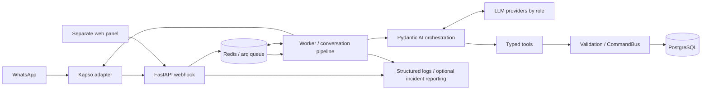

# Bolos Business — Production-Oriented AI Agent for Business Operations

## Overview

Bolos Business is a business management platform whose primary interface is an AI agent on WhatsApp. It turns natural language into structured sales, expenses, purchases, receivables, payments and financial queries. A complementary web panel is developed in a separate project.

This repository preserves the real backend, agent orchestration, migrations and automated tests in an independent, sanitized snapshot. It is a source showcase; external messaging and model services require separately configured credentials.

## Why I Built It

Small businesses often run through WhatsApp conversations, calculators, notebooks and manual records. I built Bolos to connect that conversational workflow to consistent, auditable business records without requiring owners to learn accounting software first.

## My Role

I am the Founder & Software Engineer. I designed and developed the technical architecture, backend, agent system, integrations and reliability mechanisms, taking ownership from data modeling and provider integration through financial validation and regression testing.

## Key Engineering Challenges

- **Reliable tool calling for financial operations:** [typed tools](app/agent/tools/writes.py), [orchestration](app/agent/orchestrator.py) and [money evidence](app/agent/money_evidence.py) constrain what model proposals can become.
- **Deterministic validation and transactional integrity:** the [CommandBus](app/application/bus.py) coordinates application commands; [domain money rules](app/domain/money.py) use Decimal.
- **Multi-tenant isolation and role-based authorization:** [execution context](app/application/context.py), [panel authentication](app/api/panel/auth.py) and command authorization keep identity outside model arguments.
- **Asynchronous WhatsApp processing:** [webhooks](app/api/webhooks.py), [worker](app/worker.py) and [pipeline](app/agent/pipeline.py) separate request acknowledgement from conversation processing.
- **Evaluations and regression testing:** [tests](tests), [evaluation cases](evals/cases.py) and [observability adapters](app/infra/observability) cover tool behavior and operational failures.
- **Provider abstraction and cost optimization:** [LLM roles](app/llm/roles.py) and [usage observation](app/llm/observability.py) support role-specific model selection and accounting.

## Architecture



See [architecture](docs/architecture.md), [agent design](docs/agent-design.md) and [evaluation](docs/evaluation.md).

## Technology Stack

Python 3.13, FastAPI, Pydantic AI, PostgreSQL, SQLAlchemy asyncio, Alembic, Redis, arq, Docker, httpx, pytest and Ruff. Model adapters support Google Gemini and OpenAI-compatible DeepSeek APIs. Messaging uses a provider port with Kapso and console implementations. Optional integrations include S3-compatible attachment storage and Sentry.

## Evaluation and Reliability

Scripted-model tests check deterministic orchestration without model credentials. Database integration tests exercise commands against PostgreSQL and Redis. Live-model evaluations separately check natural language interpretation and persisted outcomes using synthetic seeds. Money evidence, scoped commands, confirmation state, idempotency and deterministic receipts reduce the risk of model text being mistaken for a completed financial operation. These controls have limits; passing tests is not a security certification.

## Real-World Usage

The product has attracted its first paying business customer, with a solution built on the Bolos core.

## Getting Started

Install Docker with Compose. From this directory:

```bash
cp .env.example .env
docker compose --profile test run --build --rm test
docker compose --profile test run --rm --no-deps test lint-imports --no-cache
docker compose --profile test run --rm --no-deps test ruff check app tests evals security_tests
```

The test profile uses disposable PostgreSQL and Redis services and requires no production credentials. Do not substitute an existing database: test fixtures reset their database and Redis state. Service-free authentication regressions can also run in a Python 3.13 virtual environment:

```bash
uv sync --frozen
PYTHONPATH=. .venv/bin/pytest --confcutdir=security_tests security_tests
```

A full conversation requires your own model API credentials and makes paid external calls. WhatsApp additionally requires a messaging account and signed webhook configuration. No credentials or customer datasets are supplied. Console messaging is the default; signup is closed in the example configuration. The web panel is not included. This snapshot has not been validated as a production deployment.

## Security

The backend implements signed webhook checks, session validation, role checks, scoped execution contexts and command validation. System administration requires password-authenticated authority; legacy destructive system maintenance is disabled in this distribution. Report concerns privately using [SECURITY.md](SECURITY.md).

## License

[PolyForm Noncommercial License 1.0.0](LICENSE). Code is public for review, learning and noncommercial uses permitted by the license. Commercial use requires separate authorization or a separate license. Bolos Business is a commercial product developed and maintained independently. Dependencies retain their own licenses. See [NOTICE](NOTICE).

## Author

Enrique Uzcategui — [GitHub](https://github.com/enriqueuz)
